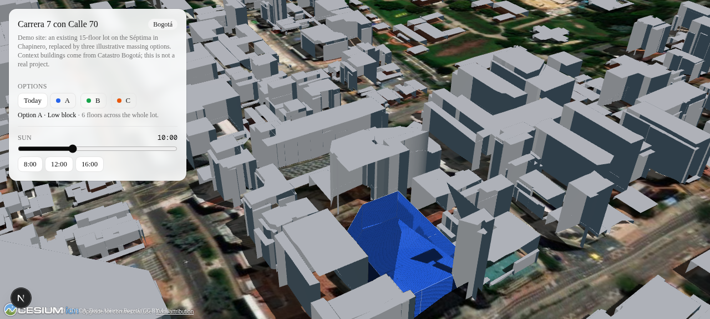
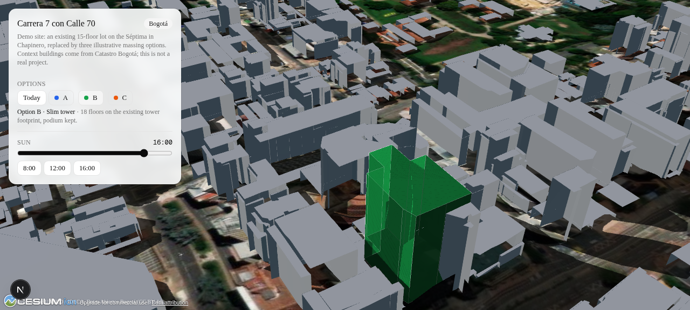

# maqueta

Public consultation sites for infrastructure projects. Real city context, design options side by side, in the browser.

A *maqueta* is the physical model shown at every public hearing. This is the digital one: a page per project where residents compare options against the city as it is today, run a sun study, and (soon) leave comments and vote.

## Status

First milestone: a Bogotá demo with Catastro building footprints extruded over Cesium World Terrain, three illustrative massing options on a lot in Chapinero, and a sun slider.

## Stack

- Next.js 16 (App Router, cache components), React 19, Tailwind 4, shadcn, Geist
- CesiumJS 1.146 with Cesium ion (terrain + imagery), Google Photorealistic 3D Tiles behind a per-site flag
- pnpm workspace, Biome, Vitest

## Layout

```
apps/web            Next.js app. One route per site: /[site]
  sites/*.json      Site definition: camera, context sources, proposals
  public/tilesets   Generated 3D Tiles (committed for the demo)
packages/catastro   Catastro Bogotá → 3D Tiles pipeline
```

## Run

```bash
pnpm install
cp apps/web/.env.example apps/web/.env.local   # add NEXT_PUBLIC_CESIUM_ION_TOKEN and NEXT_PUBLIC_GOOGLE_MAPS_API_KEY
pnpm --filter @maqueta/web dev
```

## Regenerate the Chapinero context

Pulls building footprints from the UAECD "Construcción" layer (CC BY 4.0), samples Cesium World Terrain at each building, extrudes by floor count, and writes a single-tile 3D Tiles 1.1 tileset.

```bash
set -a; . apps/web/.env.local; set +a
pnpm --filter @maqueta/catastro build -- --bbox=-74.060,4.651,-74.049,4.660 --out ../../apps/web/public/tilesets/chapinero
```

## Data

- Construcciones: Unidad Administrativa Especial de Catastro Distrital / IDECA, via [Datos Abiertos Bogotá](https://datosabiertos.bogota.gov.co/dataset/construccion), CC BY 4.0. `CONALTURA` and `CONELEVACI` are unpopulated, so heights are `CONNPISOS × 3 m`.
- Terrain and imagery: Cesium ion.

## License

MIT

## Screenshots

| Option A on the lot | Option B at 16:00 |
|---|---|
|  |  |

Live: https://maqueta-ecru.vercel.app/chapinero
